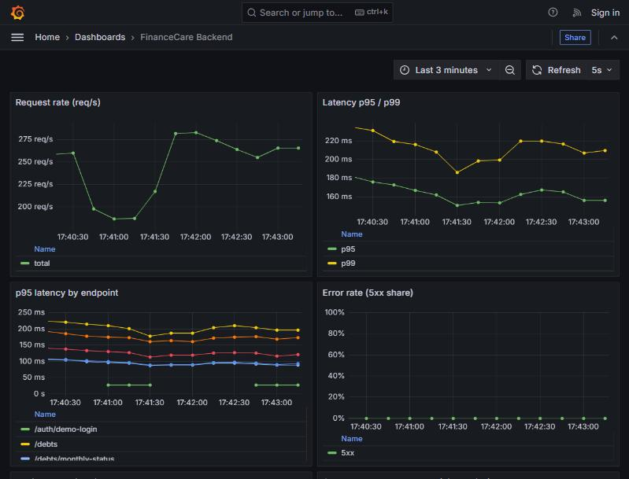
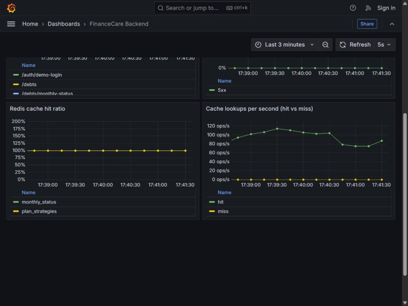
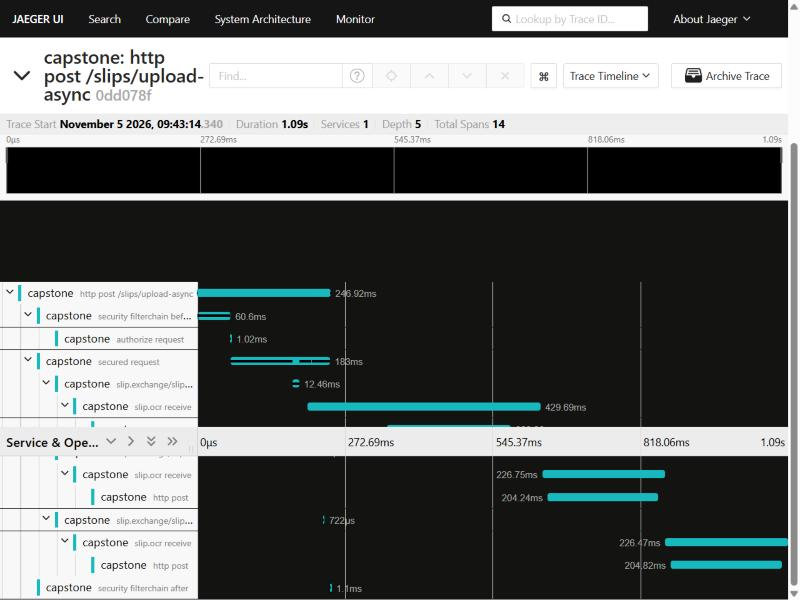

# Observability (Prometheus + Grafana)




The backend exposes Spring Boot Actuator / Micrometer metrics on a **separate management port** (`MANAGEMENT_PORT`, default `9081`), so `/actuator` is not reachable through the public API port. Only `health` and `prometheus` are exposed, and only those two are open without a token.

```bash
cd monitoring
docker compose up -d      # Prometheus :9090, Grafana :3001 (admin / admin)
```

Start the backend, then open <http://localhost:3001> and the "FinanceCare Backend" dashboard (provisioned from `grafana/dashboards`).

| Panel | Source metric |
|---|---|
| Request rate, p95/p99 latency, p95 per endpoint, 5xx share | `http_server_requests_seconds_*` (histogram buckets enabled) |
| Redis cache hit ratio and hit/miss per second | `app_cache_requests_total{cache,result}` from `CacheMetrics` |
| JVM heap | `jvm_memory_used_bytes`, `jvm_memory_max_bytes` |
| Hikari connections | `hikaricp_connections_active / pending / max` |

## Tracing (OpenTelemetry + Jaeger)



Micrometer Tracing (OpenTelemetry bridge) creates a span for every request, security filter step, RabbitMQ publish and
consume, and outgoing `RestTemplate` call (OCR, Jooble). The trace context travels in the message headers, so a slip's
upload and its background OCR show up as **one trace** (above: `POST /slips/upload-async` -> `slip.ocr send` ->
`slip.ocr receive` -> `http post` to the OCR service, for 3 slips).

Off by default. Enable with `TRACING_ENABLED=true`; spans go to `OTLP_TRACES_ENDPOINT` (default
`http://localhost:4318/v1/traces`, the Jaeger service in `docker-compose.yml`), UI at <http://localhost:16686>.
`TRACING_SAMPLE_RATE` (default `1.0`) should be lowered in production. The trace id is on every log line next to the
request id.

Not traced: JDBC and Redis calls (no instrumentation added).

## Logging

Every request gets a correlation id (`RequestIdFilter`): it is reused from `X-Request-Id` when it is a short safe token, otherwise generated, returned in the response header and added to each log line (`[requestId]`). For JSON logs set `LOGGING_STRUCTURED_FORMAT_CONSOLE=ecs` (Spring Boot 3.4 structured logging); the id is then a field of each log object.

## Notes

- The SMTP health check is disabled (`management.health.mail.enabled=false`): it would make `/health` slow or fail whenever Gmail is unreachable.
- Prometheus reaches the backend on the host through `host.docker.internal` (the compose file adds the Linux mapping).
- Screenshots were taken while `loadtest/k6/api.js` ran with 30 virtual users.
